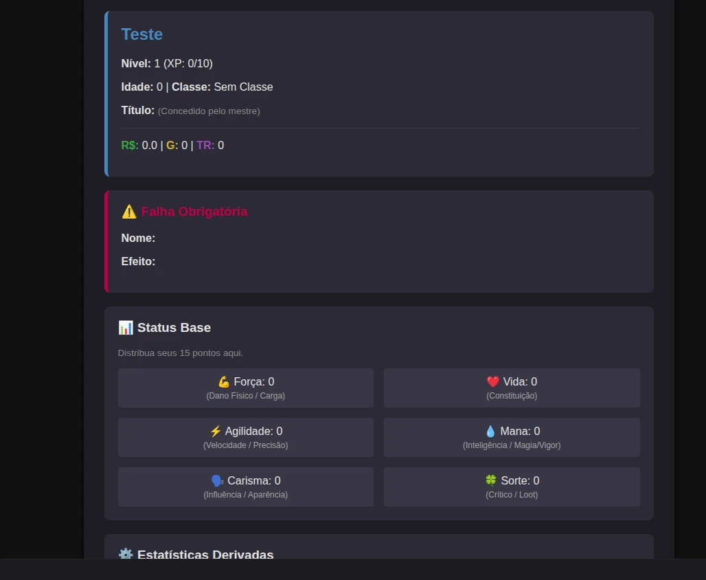
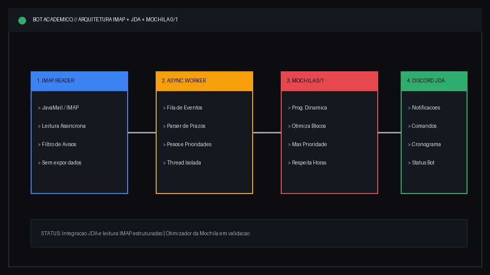

# 💻 Portfólio Profissional — Victor Eduardo

[](https://victoreduardo-coder.github.io/portfolio/)
[](https://www.linkedin.com/in/victoreduardo-coder/)
[](https://github.com/VictorEduardo-coder)

Portfólio interativo e bilíngue (PT/EN) de **Victor Eduardo Almeida dos Santos**, graduando em **Engenharia da Computação na Universidade Federal de Goiás (UFG)**, com foco em **Desenvolvimento Backend, Segurança de Aplicações, Automação e Engenharia Assistida por IA**.

---

## Sobre o Projeto

Construído com **HTML semântico, CSS modular e JavaScript puro (ES Modules)** — sem dependências de runtime — o portfólio reúne os principais sistemas públicos (com suítes de testes automatizados e CI no GitHub Actions), capturas reais das aplicações, decisões de arquitetura, currículo atualizado em PDF e um **Tech Lab** interativo que executa inteiramente no navegador.

<p align="center">
  
  
</p>

---

## Principais Recursos

- **Apresentação & Currículo Atualizado:** Trajetória na UFG, experiência prévia em TI/Administrativo e currículo público em PDF sem exposição de dados sensíveis.
- **Matriz de Projetos & Inspetor de Arquitetura:** Filtros por área, tecnologia e status, galeria interativa com telas reais, cobertura de segurança/CI e detalhamento transparente de escopo.
- **Tech Lab (Simulações Interativas no Navegador):**
  - Simulador de API REST & validação de payloads JSON;
  - Laboratório passo a passo de Algoritmos e Estruturas de Dados (Mochila 0/1, QuickSort, Busca Binária/Linear, Pilha e Fila);
  - Monitor de telemetria simulado e playground de código (Java/Spring Boot, C11 e Python/SQLite).
- **Bilíngue (PT-BR / EN), Carregamento Direto & SEO:** Carregamento imediato (efeito de agentes opcional no cabeçalho), fallback offline sincronizado e metadados Open Graph / Twitter Card com card dedicado (`og-cover.png`).
- **Testes Automatizados & CI/CD:** Validação automática de schema, imagens, metadados e algoritmos com `node` no GitHub Actions antes do deploy no **GitHub Pages**.

---

## Tecnologias Utilizadas

### Core do Portfólio


### Stack Demonstrada nos Projetos e Tech Lab


---

## Como Executar Localmente

```bash
# 1. Clone o repositório
git clone https://github.com/VictorEduardo-coder/portfolio.git

# 2. Acesse o diretório do projeto
cd portfolio

# 3. Execute a suíte de testes de validação (requer Node.js 18+)
npm test

# 4. Inicie um servidor HTTP local
python3 -m http.server 8000
```

Abra **`http://localhost:8000`** no navegador.

---

## Licença

Distribuído sob a licença **MIT**. Consulte o arquivo [LICENSE](./LICENSE) para mais detalhes.
